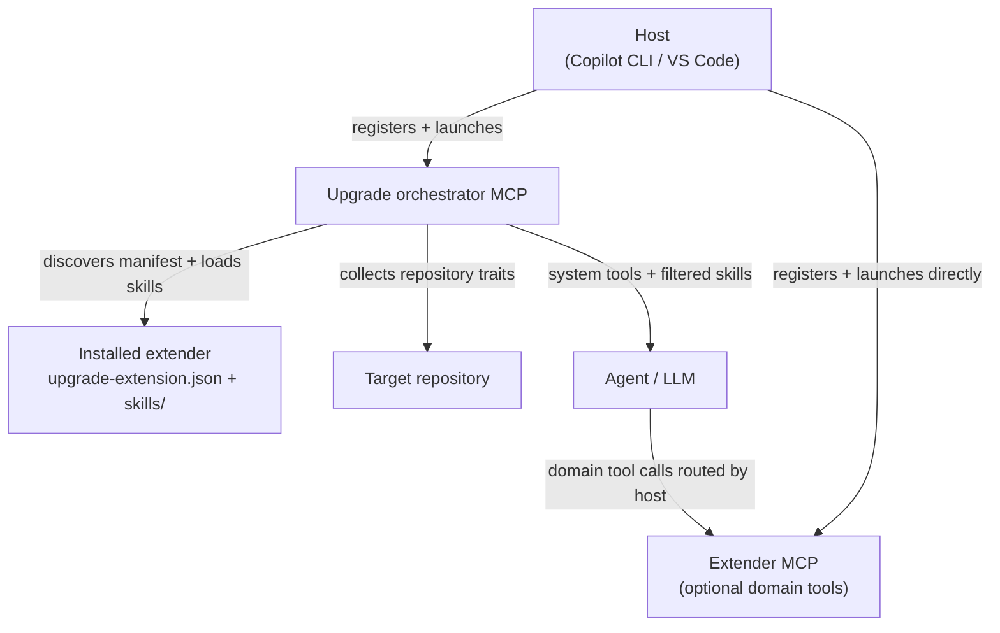

# 1. The extension model

An extender adds domain-specific skills and optional tools to the Upgrade agent.
The manifest and skill format are shared across hosts; MCP registration uses
each host's standard integration. See docs [2](02-copilot-cli-plugin.md) and
[3](03-vscode-extension.md) for packaging.

## 1.1 Topology



The orchestrator owns workflow coordination, system tools, skills, and scenario
discovery. Your MCP is an independent server: the host registers it, launches it,
and routes tool calls directly to it.

## 1.2 What an extender contributes

| Surface | Required? | What it is |
|---------|-----------|------------|
| **Manifest** (`upgrade-extension.json`) | Yes | Identifies the extender and declares optional skill roots and skill trait gates. |
| **Skills** (`skills/`) | Recommended | Markdown scenarios and on-demand guidance the agent follows. |
| **MCP server** | Optional | Domain tools, registered through the host's normal MCP integration. |
| **Upgrade hooks** (`upgradeHooks`) | Optional | One-shot commands the orchestrator invokes to collect repository facts. |

A skills-only extender needs just its host package, Upgrade manifest, and skills.
An extender with tools also supplies native MCP registration in its host package
or, for a CLI agent-scoped server, in a sub-agent's YAML header.

## 1.3 The manifest: `upgrade-extension.json`

Place this JSON file at the root of your extender folder:

```json
{
  "id": "upgrade-fabrikam",
  "displayName": "Fabrikam Suite Upgrade",
  "version": "1.0.0",
  "traits": ".NET|CSharp|VisualBasic|DotNetCore"
}
```

| Field | Required | Description |
|-------|----------|-------------|
| `id` | Yes | Globally unique, lowercase, hyphenated (`^[a-z][a-z0-9-]{2,63}$`). Scenarios reference it in `requires-extension`. |
| `displayName` | Yes | Human-readable name shown in diagnostics. |
| `version` | Yes | SemVer of your extender, independent of the orchestrator. |
| `enabled` | No | Enables Upgrade content and hooks (default `true`). Host MCP registration is configured independently. |
| `traits` | No | Expression gating all skills from this extender. Empty/omitted means always applicable. |
| `skills` | No | Extra skill-root path(s) relative to the manifest, merged with the conventional skill directories. |
| `upgradeHooks` | No | One-shot command definitions keyed by hook name; `collect_facts` collects repository facts and traits. |

The [sample authoring schema](upgrade-extension.schema.json) describes this
manifest shape for standalone extenders using native MCP registration. Configure
MCP launch commands, arguments, environment variables, and tool permissions in
the host's MCP configuration. The Upgrade manifest describes Upgrade content.

Upgrade hooks are independent of MCP registration. Each hook command reads a
JSON request from stdin, writes one JSON response to stdout, and exits.
Its definition supplies `command`, optional `args`, `workingDirectory`, and
`timeoutSeconds`. Hook paths can use `${pluginRoot}` to refer to the folder
containing the manifest.

## 1.4 Skills layout

The orchestrator merges skills from `skills/`, `upgrade/skills/`, and any
additional roots listed in `skills`:

```text
<extender-root>/
├── upgrade-extension.json
└── skills/
    ├── fabrikam-v4-upgrade/SKILL.md
    └── fabrikam-package-audit/SKILL.md
```

Additional roots must stay inside the extender folder. Skill-id collisions
across roots are de-duplicated. See [doc 4](04-skills.md) for the skill format.

## 1.5 Traits and gating

The orchestrator collects repository **traits**: boolean facts about technologies
present. Broad discovery traits include `DotNet`, `Containerized`, and `Azure`;
deeper analysis can contribute capability traits such as `.NET`, `CSharp`, and
`DotNetFramework`.

Use traits at two levels:

1. **Manifest `traits`** gates all skills contributed by the extender.
2. **Skill `metadata.traits`** adds a gate for an individual skill.

Expressions support `|` (OR), `&` / `+` (AND), `!` (NOT), and parentheses,
and are case-insensitive. For example: `"DotNet & !Containerized"`.

Traits govern skill availability, not MCP launch or tool access. They also do
not gate fact-collection hooks, which help produce the traits. Configure tool
access through host permissions, agent tool scopes, and your MCP server.
See [doc 5](05-skills-metadata-and-traits.md) for the trait catalog.

## 1.6 Discovery and lifecycle

1. The host registers the Upgrade MCP and your independently configured MCP.
2. The orchestrator discovers installed `upgrade-extension.json` manifests and
   loads enabled extenders' skills and hooks.
3. Repository scanning and fact collection produce traits.
4. The orchestrator filters skills using extender-level and skill-level gates,
   re-evaluating them as traits change.
5. The agent follows the selected scenario and calls tools through the host.
   `requires-extension` identifies scenario dependencies; it is not an MCP
   launch instruction.

## 1.7 Bundling several extenders

A host package can carry several self-contained `extenders/<name>/` folders,
each with its own manifest and skills. Keep each folder independently usable.
The orchestrator discovers nested manifests; VS Code packages explicitly list
each manifest path in `contributes.upgradeExtensions`. Register any MCP servers
through the host package's normal MCP integration.

## Next

- Package for Copilot CLI → [doc 2](02-copilot-cli-plugin.md)
- Package for VS Code → [doc 3](03-vscode-extension.md)
- Write skills → [doc 4](04-skills.md)
