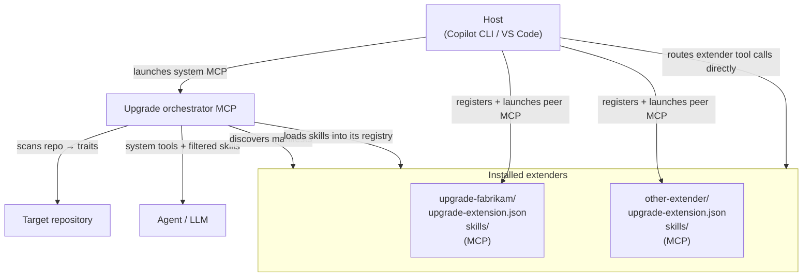

# 1. The extension model

This page explains how an extender plugs into the Upgrade agent. The model is
**host-agnostic**: the same manifest, skills, and tool surface work whether you
ship a Copilot CLI plugin or a VS Code extension. MCP registration is
**host-specific**, not part of the shared skill-discovery path. Packaging is
covered in docs [2](02-copilot-cli-plugin.md) and [3](03-vscode-extension.md).

## 1.1 Topology



**Key invariant.** Extender MCPs are **peers of the orchestrator**, not its
children. The host launches them and routes their tool calls directly. The
orchestrator discovers manifests and loads skills; it does not proxy domain
tools.

| Host / scope | Where to declare MCP servers |
|--------------|------------------------------|
| Copilot CLI, plugin-wide | `plugin.json` → `mcpServers`, inline or pointing to a separate `mcp.json`. |
| Copilot CLI, agent-local | The sub-agent's YAML `mcp-servers` block. |
| VS Code Upgrade extender | `upgrade-extension.json` → `mcp`; the Upgrade host registers the server with VS Code. |

**The `mcp` block in `upgrade-extension.json` is not used by standalone CLI
plugins.** Copying it into a CLI extender does not register or launch a server.
Use one of the CLI registration locations above instead. Build tooling for
extenders bundled into the Upgrade product may generate host registrations from
manifests; that is a packaging step, not CLI runtime discovery of this block.

## 1.2 What an extender contributes

| Surface | Required? | What it is |
|---------|-----------|------------|
| **Manifest** (`upgrade-extension.json`) | Yes | Identifies the extender; declares id/version, skill trait gates and optional VS Code MCP launch data. |
| **Skills** (`skills/`) | Recommended | Markdown scenarios, on-demand guidance, and **scenario extensions** the agent follows. An extender can be skills-only. |
| **MCP server** | Optional | A process exposing tools the agent calls. Omit if your extender is skills-only. |
| **Sub-agents** (`agents/`) | Optional | Hidden `*.agent.md` worker agents the orchestrator dispatches by name. Each may declare **its own** `mcp-servers`. See [doc 8](08-sub-agents.md). |
| **Hooks** | Reserved | Folder reserved for a future hooks runtime. Not yet active. |

A useful extender is usually **skills + an MCP server**, but **skills-only**
extenders are fully supported — omit MCP registration and ship no MCP project.

Skills come in a few shapes, and the shape decides *when* your guidance reaches
the agent. Pick per piece of content — most extenders ship a mix:

- **On-demand guidance** (`lazy`) — loaded when the agent matches its
  description to the task. The workhorse, and the right default for most of
  what you write.
- **Always-on rules** (`preload`) — short, broadly-applicable constraints kept
  in context for every session. Use sparingly; it costs tokens whether or not
  it's relevant.
- **A scenario** — an end-to-end workflow of your own that the user can pick.
- **A scenario extension** — your rules injected into a workflow the
  orchestrator already owns. If your technology shows up *inside* somebody
  else's migration, this is the surface you want
  ([doc 6](06-scenario-extensions.md)).

All four are covered in [doc 4](04-skills.md).

## 1.3 The manifest: `upgrade-extension.json`

A single JSON file at the root of your extender folder. Minimal form:

```jsonc
{
  "id": "upgrade-fabrikam",
  "displayName": "Fabrikam Suite Upgrade",
  "version": "1.0.0"
}
```

Shared form with skill trait gating (works on both hosts):

```jsonc
{
  "id": "upgrade-fabrikam",
  "displayName": "Fabrikam Suite Upgrade",
  "version": "1.0.0",
  "traits": ".NET|CSharp|VisualBasic|DotNetCore"
}
```

| Field | Required | Description |
|-------|----------|-------------|
| `id` | Yes | Globally unique, lowercase, hyphenated (`^[a-z][a-z0-9-]{2,63}$`). Scenarios reference it in `requires-extension`. |
| `displayName` | Yes | Human-readable name shown in diagnostics. |
| `version` | Yes | SemVer of your extender, independent of the orchestrator. |
| `mcp` | No | **VS Code only:** host MCP registration/launch settings. **Ignored for CLI plugin MCP registration.** See below. |
| `enabled` | No | Enables Upgrade content (default `true`); does not disable separately registered MCP servers. |
| `traits` | No | A trait expression gating the extender's skills, not its MCP tools. Empty/omitted = always applies. See §1.5. |
| `skills` | No | Extra skill-root path(s) relative to the manifest, merged with the conventional `skills/` lookup. |

> The full machine-readable schema is mirrored at
> [`docs/upgrade-extension.schema.json`](upgrade-extension.schema.json). Point
> your editor's JSON validation at it for IntelliSense.

### The `mcp` block (VS Code only, not CLI plugin configuration)

The VS Code Upgrade host reads this block from contributed manifests and
registers each server directly with VS Code. It does not make the orchestrator
launch or proxy the server. For CLI registration, use
[doc 2](02-copilot-cli-plugin.md), not this block.

```jsonc
"mcp": {
  "serverName": "FabrikamUpgrade",          // host registration / tool scope
  "command": "dnx",                        // launcher: dnx, npx, dotnet, node, …
  "args": ["Fabrikam.Upgrade.Mcp", "--yes"],
  "env": {
    "FABRIKAM_LOG_LEVEL": "info"            // optional server environment
  },
  "workingDirectory": null                 // optional; ${pluginRoot} token allowed
}
```

`command` + `args` is whatever launches your MCP server over stdio — there is no
requirement to ship server code alongside the manifest. Common forms: `dnx`
(a published .NET tool), `npx -y <package>` (a published npm package), or a
direct `dotnet`/`node` invocation. Path arguments may use the `${pluginRoot}`
token, which the VS Code host resolves against the manifest's folder.
Do not confuse it with CLI's case-sensitive `${PLUGIN_ROOT}` token in native
plugin MCP configuration.

The optional `mcp.env` object supplies environment variables to **that MCP
server when VS Code launches it**. Use string values, including for booleans
or numbers, and never commit credentials or other secrets. Like the rest of
manifest `mcp`, this block is **not used by CLI plugins**: put CLI server
environment variables in the native server definition's `env` in
`plugin.json` / `mcp.json` or sub-agent YAML instead.

An agent's tool allowlist must include the registered server's tools (for
example `FabrikamUpgrade/*`). An allowlist grants tool scope; it does not
register or launch a server.

## 1.4 Skills layout

The skills folder convention depends on the host:

- **Copilot CLI plugin** — place skills under `upgrade/skills/` inside the plugin folder:

  ```
  <plugin-root>/
  ├── upgrade-extension.json
  ├── upgrade/
  │   └── skills/
  │       ├── fabrikam-v4-upgrade/SKILL.md       # a scenario
  │       ├── fabrikam-package-audit/SKILL.md    # on-demand guidance
  │       └── fabrikam-controls-rules/           # a scenario extension (doc 6)
  │           ├── SKILL.md
  │           └── scopes/                        # per-scope content
  │               ├── assessment.md
  │               └── planning.md
  └── agents/
      └── fabrikam-dependency-validation.agent.md   # optional sub-agent (doc 8)
  ```

- **VS Code extension** — place skills under `skills/` beside the contributed
  `upgrade-extension.json`. For a non-conventional location, declare `skills`
  in that manifest, not in the `contributes.upgradeExtensions` path list:

  ```
  <extension-root>/
  ├── upgrade-extension.json
  └── skills/
      ├── fabrikam-v4-upgrade/SKILL.md
      ├── fabrikam-package-audit/SKILL.md
      └── fabrikam-controls-rules/
          ├── SKILL.md
          └── scopes/{assessment,planning}.md
  ```

Note that **sub-agents don't follow the skills path**: they live in a flat,
plugin-level folder — `agents/` for the CLI, `prompts/` for VS Code — never
under the skills directory. See [doc 8](08-sub-agents.md).

The orchestrator merges skills from every configured path. Skill-id collisions across layers are de-duplicated. See [doc 4](04-skills.md) for the SKILL.md format.

## 1.5 Traits and gating

The orchestrator **scans the target repository** on boot and produces a set of
**traits** — boolean facts about the technologies present. Some are coarse,
filename-level **discovery traits** (`DotNet`, `Containerized`,
`Azure`); others are finer **capability traits** surfaced by deeper
analysis (`.NET`, `CSharp`, `DotNetCore`, `DotNetFramework`). You use traits in
two places:

1. **Manifest `traits`** — the outer gate. It decides whether your extender's
   *skills are offered*. A non-matching extender contributes no skills.
   `enabled: false` disables Upgrade content, not independently registered MCP
   servers. A .NET-oriented extender can use
   `".NET|CSharp|VisualBasic|DotNetCore"`; this sample uses the same gate.
2. **Skill `metadata.traits`** — an inner gate that narrows further. It is
   **ANDed** with the manifest gate, so a skill is offered only when *both*
   evaluate true; an empty expression on either side passes. A skill can't
   escape the manifest gate by declaring traits of its own.

Trait expressions support `|` (OR), `&` / `+` (AND), `!` (NOT), and parentheses,
and are case-insensitive — e.g. `"(.NET|CSharp|VisualBasic) & DotNetFramework"`.

Neither trait gate restricts native MCP tool registration or calls. Tool access
is controlled by the host's permissions and each calling agent's tool scope.

The complete catalog of discoverable traits is in
[doc 5](05-skills-metadata-and-traits.md). Gating on the right traits is what
makes your content appear *at the right moment* and stay out of the way
otherwise.

## 1.6 Discovery & lifecycle (what the orchestrator does for you)

You don't write any of this — it's the contract the orchestrator fulfils:

1. The host launches the orchestrator when the user starts the Upgrade agent.
2. The orchestrator scans the repository and computes traits.
3. It discovers every installed extender by finding `upgrade-extension.json`
   manifests, then loads each extender's skills into its registry.
4. Separately, the host registers and launches domain MCPs from its own
   configuration: CLI plugin/agent settings, or VS Code's manifest `mcp` data.
5. As the user works, the orchestrator filters skills by traits and the active
   scenario. The host routes domain tool calls directly to their servers.

## 1.7 Bundling several extenders

A single host package can carry **multiple independent extenders**. Put each one
in its own self-contained `extenders/<name>/` folder (each with its own
`upgrade-extension.json` and its skills directory). The orchestrator discovers
every nested manifest. Keeping each extender self-contained means you can later
split one out into its own package by moving the folder.

> **Sub-agents are the exception.** Agent files are discovered in one flat,
> package-level folder, not beside each manifest, so they can't sit inside
> `extenders/<name>/`. Splitting an extender out means moving its agent files
> too. See [doc 8 §8.1](08-sub-agents.md#81-where-agent-files-end-up).

## Next

- Package for Copilot CLI → [doc 2](02-copilot-cli-plugin.md)
- Package for VS Code → [doc 3](03-vscode-extension.md)
- Write skills → [doc 4](04-skills.md)
- Extend a built-in scenario → [doc 6](06-scenario-extensions.md)
- Keep it small → [doc 7](07-instruction-size-and-tokens.md)
- Ship sub-agents → [doc 8](08-sub-agents.md)
