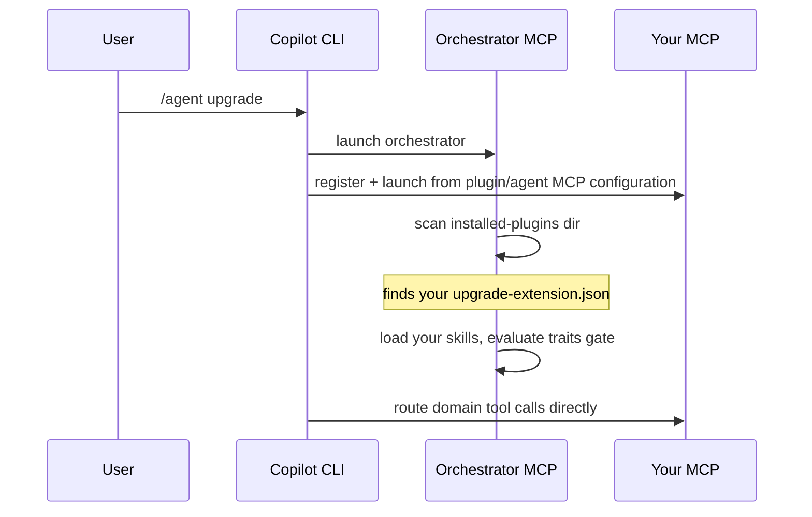

# 2. Packaging an extender as a Copilot CLI plugin

This page shows how to ship your extender as a **GitHub Copilot CLI plugin**.
The working example lives in
[`samples/copilot-cli-plugin/`](../samples/copilot-cli-plugin/).

Read [doc 1](01-extension-model.md) first — it covers the manifest, skills, and
trait gating that are shared across hosts. This page only adds the CLI-specific
packaging.

> **CLI does not use `upgrade-extension.json`'s `mcp` block.** That block is
> launch data for VS Code extenders. For a CLI plugin, configure MCP servers in
> `plugin.json` / `mcp.json`, or in a sub-agent's YAML `mcp-servers` block.
> The orchestrator no longer launches or proxies extender MCPs.

If you followed the old proxy-based guide, move your launch command out of
manifest `mcp` into one of those CLI registration locations. The former advice
to leave `mcpServers` out of `plugin.json` no longer applies.

## 2.1 Folder layout

```
copilot-cli-plugin/
├── plugin.json                 # Copilot CLI plugin metadata
├── upgrade-extension.json    # the extender manifest (see doc 1)
├── upgrade/
│   └── skills/
│       ├── fabrikam-v4-upgrade/SKILL.md          # a scenario
│       ├── fabrikam-package-audit/SKILL.md       # on-demand guidance
│       └── fabrikam-controls-rules/              # a scenario extension (doc 6)
│           ├── SKILL.md
│           └── scopes/{assessment,planning}.md
└── agents/
    └── fabrikam-dependency-validation.agent.md   # a sub-agent (doc 8)
```

The plugin ships the manifest and skills. This sample references a published
MCP package rather than bundling server code. The **CLI**, not the orchestrator,
launches the command registered in `plugin.json`.

`agents/` is optional, and only present because this sample demonstrates a
sub-agent. Note it sits at the **plugin root, not under `upgrade/`**: it is the
CLI's own flat agent folder, so agent files go there directly — see
[doc 8](08-sub-agents.md).

After the user installs the plugin, the CLI extracts it to a folder under its
installed-plugins directory. The orchestrator scans that directory, finds your
`upgrade-extension.json`, and takes over from there.

## 2.2 `plugin.json`

This is the **Copilot CLI** plugin manifest: metadata and native MCP registration.
It is *not* the Upgrade content manifest (`upgrade-extension.json`).

```jsonc
{
  "name": "upgrade-fabrikam",
  "version": "1.0.0",
  "description": "Fabrikam Suite Upgrade — sample modernization extender for the Fabrikam .NET component suite.",
  "author": { "name": "Fabrikam" },
  "license": "MIT",
  "keywords": ["modernize", "copilot", "upgrade", "dotnet", "nuget"],
  "mcpServers": {
    "FabrikamUpgrade": {
      "type": "local",
      "command": "dnx",
      "args": ["Fabrikam.Upgrade.Mcp", "--yes"],
      "tools": ["*"],
      "timeout": 300000
    }
  }
}
```

### Plugin-wide MCP registration: inline or in `mcp.json`

The example registers `FabrikamUpgrade` for plugin-wide use. Any stdio MCP
command works (`dnx`, `npx`, `node`, a bundled executable, etc.). The package
name is illustrative: replace it with your own server. `timeout` is the
initialization budget in milliseconds; a cold package download may need more
time than a cached launch.

To keep launch settings separate, replace the inline `mcpServers` map in
`plugin.json` with a file reference:

```jsonc
// plugin.json (other metadata omitted)
{ "mcpServers": "./mcp.json" }
```

```json
{
  "mcpServers": {
    "FabrikamUpgrade": {
      "type": "local",
      "command": "dnx",
      "args": ["Fabrikam.Upgrade.Mcp", "--yes"],
      "tools": ["*"],
      "timeout": 300000
    }
  }
}
```

The second block is `mcp.json` at the plugin root. This is **native CLI MCP
configuration**, not `upgrade-extension.json`. Merely adding an unreferenced
file named `mcp.json` does not wire it into this example. See the
[Copilot CLI plugin reference](https://docs.github.com/en/copilot/reference/copilot-cli-reference/cli-plugin-reference)
for supported configuration formats.

### Agent-local MCP registration: YAML `mcp-servers`

When only one worker needs a server, declare it in that worker's
`agents/<name>.agent.md` YAML frontmatter instead:

```yaml
---
name: fabrikam-package-worker
description: Inspect Fabrikam packages before planning a v4 migration.
user-invocable: false
mcp-servers:
  FabrikamUpgrade:
    type: local
    command: dnx
    args: ["Fabrikam.Upgrade.Mcp", "--yes"]
    tools: ["*"]
    timeout: 300000
tools:
  - FabrikamUpgrade/*
---
```

Choose plugin-wide **or** agent-local registration for a given server; do not
register it twice unintentionally. Agent-local servers belong to that worker:
other workers must have their own access or delegate to it. A `tools:` list
alone does not launch a server. The sample demonstrates both scopes with
**different servers**: `FabrikamUpgrade` in `plugin.json` and `fabrikam-graph`
in the dependency-validation agent. See [doc 8 §8.4](08-sub-agents.md#84-an-agent-may-declare-its-own-mcp-servers).

Use the CLI's case-sensitive `${PLUGIN_ROOT}` token for bundled file paths in
plugin MCP definitions or plugin-shipped agents. Do not copy the VS Code
manifest token `${pluginRoot}` into CLI configuration.

### Do **not** ship a visible agent file

Only the orchestrator should appear in the CLI's `/agent` list. Any agent file
you ship in `agents/` must be a hidden worker, so you must declare
`user-invocable: false` yourself — an absent key means **visible**, not hidden.
See [doc 8](08-sub-agents.md). If your extender contributes no sub-agent, ship
no agent file at all.

## 2.3 How discovery works on the CLI



**Skill discovery and MCP registration are independent.** A valid
`upgrade-extension.json` lets the orchestrator discover your Upgrade content.
It does not register a CLI MCP server. Register that server separately using
one of the locations in §2.2, and give calling workers access to its tools.
Manifest `traits`, `enabled`, and retired per-tool gates do not control native
MCP registration or permissions.

## 2.4 Skills-only plugins

If your extender contributes only skills, omit `mcpServers` and agent-local
`mcp-servers`. The plugin then ships just `plugin.json`,
`upgrade-extension.json`, and `upgrade/skills/`. The orchestrator loads the
skills; the CLI has no domain MCP to launch. An unused manifest `mcp` block
does not change either result.

## 2.5 Local development loop

1. Get your MCP server runnable by a command. Either:
   - publish it (e.g. a .NET tool consumed via `dnx`, or an npm package consumed
     via `npx`) and reference it in `plugin.json` / `mcp.json` or agent YAML, or
   - point that native MCP configuration at a local invocation
     (`dotnet run --project <abs-path>`, `node <abs-path>`, …) for a fast inner
     loop.
2. Install the plugin with `copilot plugin install <path-to-plugin>`.
3. Start a new CLI session and run `/agent upgrade`. Confirm your scenario
   appears for matching traits and the worker using domain tools can access
   `FabrikamUpgrade`. Skill visibility alone does not prove MCP registration.

> Tip: keep the published command (production launcher) in the checked-in
> manifest, and only rewrite it to a local form in a local, uncommitted copy.
> That keeps the manifest correct for users while letting you
> iterate.

## 2.6 Checklist

- [ ] `plugin.json` has a unique `name`.
- [ ] `upgrade-extension.json` `id` matches `plugin.json` `name` and is unique.
- [ ] MCP settings are in `plugin.json` / a referenced `mcp.json`, or the
      owning agent's YAML `mcp-servers` — **not** manifest `mcp`.
- [ ] The launch command resolves after install and the calling worker's tool
      scope includes the server. Omit MCP registration for skills-only.
- [ ] Skills gate on the right traits (see [doc 5](05-skills-metadata-and-traits.md)).
- [ ] Any scenario extension declares `scope` — without it, it is never used
      (see [doc 6](06-scenario-extensions.md)).
- [ ] Any agent file in `agents/` declares `user-invocable: false` and a
      uniquely-prefixed name (see [doc 8](08-sub-agents.md)).
- [ ] Tool names are unique within your server and ≤ ~40 chars.
- [ ] Content is sized against [doc 7](07-instruction-size-and-tokens.md).

## 2.7 Troubleshooting MCP configuration

| Symptom | Check |
|---------|-------|
| Skills appear but domain tools do not | Register the server in native CLI MCP configuration; `upgrade-extension.json` only enabled content discovery. |
| Only the dedicated worker can call the tools | Its server is agent-local. Delegate to it or deliberately choose plugin-wide registration and grant the caller tool access. |
| MCP starts twice | Remove accidental duplicate plugin-wide and agent-local registrations for the same server. |
| Launch arguments contain a literal `${pluginRoot}` | Use `${PLUGIN_ROOT}` in CLI plugin MCP configuration, not VS Code's manifest token. |
