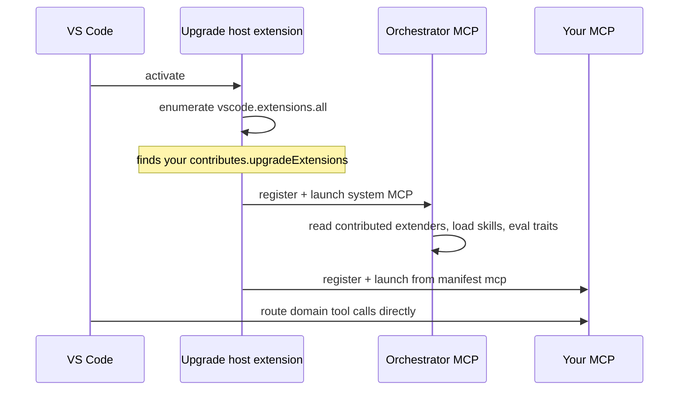

# 3. Packaging an extender as a VS Code extension

This page shows how to ship your extender as a **VS Code extension**. The
working example lives in
[`samples/vscode-extension/`](../samples/vscode-extension/).

Read [doc 1](01-extension-model.md) first for the manifest, skills, and trait
gating shared across hosts. This page only adds the VS Code-specific packaging.

> **VS Code, not CLI:** the Upgrade host reads `mcp` from contributed
> `upgrade-extension.json` manifests to register peer MCP servers with VS Code.
> The CLI plugin runtime does not use that block; see
> [doc 2](02-copilot-cli-plugin.md) for `plugin.json` / `mcp.json` and agent YAML.

## 3.1 Folder layout

```
vscode-extension/
├── package.json                # VS Code extension manifest + contribution
├── extension.js                # a no-op activation entry point
├── .vscodeignore
├── upgrade-extension.json     # the extender manifest (see doc 1)
└── skills/
    ├── fabrikam-v4-upgrade/SKILL.md          # a scenario
    ├── fabrikam-package-audit/SKILL.md       # on-demand guidance
    └── fabrikam-controls-rules/              # a scenario extension (doc 6)
        ├── SKILL.md
        └── scopes/{assessment,planning}.md
```

Your VSIX is a **data contribution**: it declares where your manifest, skills,
and MCP launch instructions live, then gets out of the way. It does **not**
register a server itself — the **Upgrade host extension** does that from the
manifest. The orchestrator neither launches nor proxies extender servers.

## 3.2 The `contributes.upgradeExtensions` contribution point

This is the heart of the VS Code packaging. Declare one manifest path per extender:

```jsonc
{
  "name": "upgrade-fabrikam",
  "displayName": "Fabrikam Suite Upgrade",
  "publisher": "fabrikam",
  "version": "1.0.0",
  "engines": { "vscode": "^1.95.0" },
  "activationEvents": [],
  "main": "./extension.js",
  "contributes": {
    "upgradeExtensions": ["./upgrade-extension.json"]
  }
}
```

Each path is relative to the VSIX root. The host reads that manifest's identity,
skill roots, and optional `mcp` block. The sample manifest contains:

```jsonc
{
  "id": "upgrade-fabrikam",
  "displayName": "Fabrikam Suite Upgrade",
  "version": "1.0.0",
  "traits": ".NET|CSharp|VisualBasic|DotNetCore",
  "mcp": {
    "serverName": "FabrikamUpgrade",
    "command": "dnx",
    "args": ["Fabrikam.Upgrade.Mcp", "--yes"],
    "env": {
      "FABRIKAM_LOG_LEVEL": "info"
    }
  }
}
```

The package is illustrative; replace it with your own server. `command` and
`args` can launch any stdio MCP implementation (`dnx`, `npx`, `node`, etc.).
For local development, use a command such as
`dotnet run --project <absolute-path>`. For bundled files, the host resolves
`${pluginRoot}` against the manifest's directory.

The optional **`mcp.env`** map is passed to the MCP server when the VS Code
Upgrade host launches it. For example, the block above sets
`FABRIKAM_LOG_LEVEL=info` in the server's environment. All values are strings;
use only variables your server understands and do not check in credentials.
CLI plugins do not read this manifest block, including its `env`: configure
`env` in the CLI server definition in `plugin.json` / `mcp.json` or sub-agent
YAML instead.

`serverName` is the registered tool scope, for example `FabrikamUpgrade/*`.
When omitted it is derived from the extender id. Do not register the same server
again in your own MCP provider unless you intentionally want another instance.
The former contribution-object `mcp[]` transport list is not the configuration
shown here: launch settings now live in the manifest.

## 3.3 Recommended `package.json` metadata

- **`activationEvents: []`** — your extension never needs to activate. VS Code
  reads the contribution point at host startup; no JS runs.
- **No `extensionDependencies`** — the orchestrator host extension loads
  independently. Declaring a dependency can prevent your VSIX from loading in
  some development configurations.
- **A no-op `extension.js`** is all you need:

  ```js
  exports.activate = function () { /* no-op */ };
  exports.deactivate = function () { /* no-op */ };
  ```

## 3.4 How discovery works in VS Code



The Upgrade host extension collects every contributed extender, hands the list
to the orchestrator for skill discovery, and registers each declared MCP
directly with VS Code. Extender servers are peers of the orchestrator and
appear separately in **MCP: List Servers**. Manifest trait gates filter skills,
not MCP tool access; give each calling worker the tools it needs.

## 3.5 A note on tool names in VS Code

VS Code Copilot Chat namespaces every MCP tool it registers as
`mcp_<serverLabel>_<toolName>`. Your tools use their **own registered server's**
label, not the orchestrator's. A tool you expose as
`detect_fabrikam_packages` reaches the model as
`mcp_FabrikamUpgrade_detect_fabrikam_packages`. The chat UI strips the prefix for
display. This is a VS Code presentation detail you don't control; **don't rename
your tools to work around it.** Skill prose should refer to the bare tool name —
every host resolves it.

## 3.6 Multiple extenders & self-discovery

`contributes.upgradeExtensions` is an array, so one VSIX can contribute several
extenders — point each entry at its own `./extenders/<name>/upgrade-extension.json`.
Keep each manifest beside its skills and optional MCP launch data so it can
later be split into its own VSIX by moving the folder and its array entry.

## 3.7 Sub-agents in VS Code

If your extender ships sub-agents ([doc 8](08-sub-agents.md)), VS Code needs two
things rather than one, because **it does not auto-discover agent files**:

1. The `*.agent.md` files must be staged into the extension's flat `prompts/`
   folder — not left nested beside `upgrade-extension.json`.
2. Each one must be listed in `contributes.chatAgents` in `package.json`, as an
   object with a `path` — not a bare string:

```jsonc
"contributes": {
  "chatAgents": [
    { "path": "prompts/fabrikam-dependency-validation.agent.md" }
  ]
}
```

Because the list is checked in, it can't be generated at build time: adding an
agent file without adding its entry means the agent simply doesn't load.

The rest mostly matches the CLI: you must declare `user-invocable: false`
yourself, and names must be globally unique. One VS Code difference worth
knowing: an agent-local `mcp-servers` block is **not launched by VS Code today**
— it is honoured by the Copilot CLI agent runtime. Don't build a VS Code-only
sub-agent around its own server. This sample ships no sub-agent; the Copilot CLI
sample does.

## 3.8 Checklist

- [ ] Each `contributes.upgradeExtensions` path resolves to a packaged manifest.
- [ ] `activationEvents` is empty and `extension.js` is a no-op.
- [ ] No `extensionDependencies`.
- [ ] Manifest `mcp.command` / `mcp.args` resolve on the user's machine, or
      `mcp` is omitted for skills-only content.
- [ ] The calling worker has access to the separately registered domain tools.
- [ ] Any server environment variables are in manifest `mcp.env`, use string
      values, and contain no secrets.
- [ ] Skills gate on the right traits (see [doc 5](05-skills-metadata-and-traits.md)).
- [ ] Any scenario extension declares `scope` — without it, it is never used
      (see [doc 6](06-scenario-extensions.md)).
- [ ] Any sub-agent is staged to `prompts/` **and** listed in
      `contributes.chatAgents`.
- [ ] Content is sized against [doc 7](07-instruction-size-and-tokens.md).
